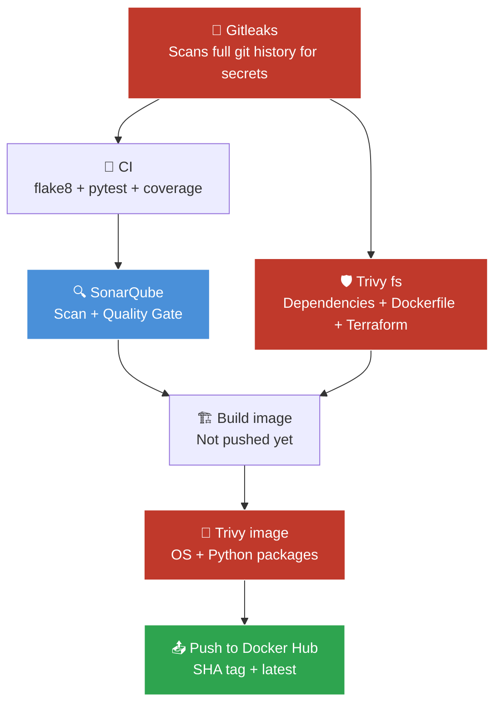
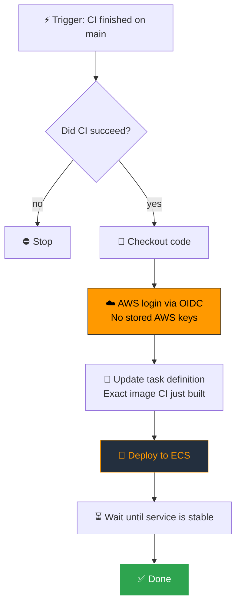
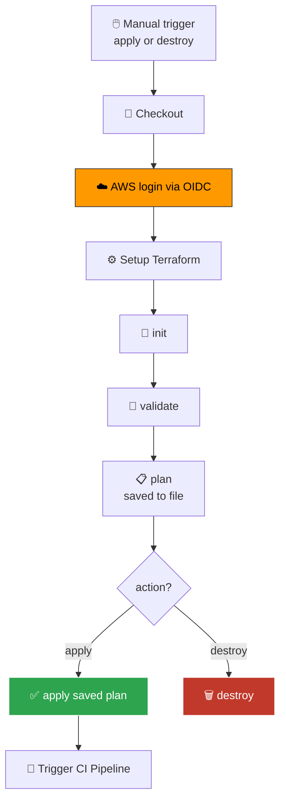

# URL Shortener — A DevSecOps CI/CD Pipeline Project

A **DevSecOps project**. The URL shortener app is kept simple on purpose. The real focus of this repo is the pipeline: security checks are built into every stage, not added at the end.

Every push to `main` runs this flow:

**secret scan → lint + tests → SonarQube quality gate → dependency / IaC scan → build image → scan image → push image → deploy to AWS ECS Fargate.**

Nothing reaches Docker Hub, and nothing reaches AWS, unless every earlier check passed.

---

## Tech Stack

| Area            | Tools                                                    |
| --------------- | -------------------------------------------------------- |
| Backend         | FastAPI (Python 3.12), SQLAlchemy, PyMySQL               |
| Database        | MySQL                                                    |
| Container       | Docker (non-root user), Docker Compose for local         |
| Cloud           | AWS ECS Fargate                                          |
| IaC             | Terraform (VPC, Security Group, ECS, IAM)                |
| CI/CD           | GitHub Actions                                           |
| Security        | Gitleaks, SonarQube, Trivy (fs + image), GitHub OIDC     |
| Image registry  | Docker Hub                                               |

---

## App (short version)

A simple URL shortener API: custom aliases, expiry, QR codes, bulk shorten, click stats. No login, no rate limiting, no analytics tables, so the pipeline stays the main focus.

---

## CI Pipeline



### Job order and why

| Job           | Needs               | Why it sits here                                                                     |
| ------------- | ------------------- | ------------------------------------------------------------------------------------ |
| `gitleaks`    | none                | First on purpose. If a secret leaked, nothing else should run on that code.          |
| `ci`          | `gitleaks`          | Lint + tests + coverage report.                                                      |
| `trivy-fs`    | `gitleaks`          | Needs only repo files, not `ci` output, so it runs **in parallel** with `ci`.        |
| `sonar`       | `ci`                | Needs `coverage.xml` from `ci` (passed as an artifact).                              |
| `trivy-image` | `sonar`, `trivy-fs` | Builds the image locally and scans it. Runs only after every earlier gate is green.  |
| `docker`      | `trivy-image`       | Pushes to Docker Hub only after the image scan passes.                               |

**Rule used:** if a job needs another job's output, use `needs`. If it does not, run it in parallel and save time.

### What each stage does

**1. Gitleaks** scans the whole git history (`fetch-depth: 0`), not just the latest commit. A secret deleted in a later commit is still in history and still gets caught. If a real secret is ever found, rotate it first, then clean the history.

**2. CI (lint + test)** `flake8` checks style, `pytest` with `coverage` runs the tests. `coverage.xml` is uploaded as an artifact because each job runs on a fresh runner, and files do not carry over between jobs.

**3. Trivy fs** scans the repository without needing an image:
- `requirements.txt` for known CVEs
- `Dockerfile` for misconfigurations (for example, running as root)
- Terraform files for AWS misconfigurations

Secret scanning is turned off here (`scanners: vuln,misconfig`) because Gitleaks already covers it.

**4. SonarQube** checks the code you wrote: bugs, code smells, security hotspots, and test coverage. The Quality Gate stops the pipeline if it fails. Trivy checks the packages you installed, SonarQube checks your own code. They do different jobs.

**5. Trivy image** scans the built image: base OS packages and every Python package inside it. It fails on `HIGH` / `CRITICAL` issues that have a fix available (`ignore-unfixed: true`). The image is scanned **before** it is pushed, so a vulnerable image never reaches the registry.

**6. Push** Docker Hub login happens only after all scans pass. The image gets two tags: the commit SHA and `latest`.

---

## CD Pipeline



**Only runs after CI succeeds.** CD waits for the CI workflow and continues only if it passed (`github.event.workflow_run.conclusion == 'success'`).

**Concurrency control**

```yaml
concurrency:
  group: deploy-production
  cancel-in-progress: false
```

If two CI runs finish close together, their deploys queue instead of updating the same ECS service at once.

**AWS login with OIDC, no stored keys.** There is no `AWS_ACCESS_KEY_ID` or `AWS_SECRET_ACCESS_KEY` in this repo.

1. GitHub issues a short-lived signed token for the workflow run.
2. AWS validates it against the OIDC provider (`token.actions.githubusercontent.com`).
3. An IAM role (`githubIdentityRoleECS`), locked to this repo and branch, is assumed and returns temporary credentials for that one run.

**Deploy the exact image that was scanned.** The task definition uses the commit SHA (`workflow_run.head_sha`), not `latest`. The image that passed the scans is the image that runs.

---

## Infrastructure Pipeline (`infrastructure.yml`)

AWS infrastructure (ECS cluster, base task definition, networking, IAM) is built with **Terraform**, and is deliberately **separate** from the push-triggered pipeline.

**Why manual:** code changes on every commit, infrastructure should change only when someone decides it needs to. Running `terraform apply` on every push would touch live networking and cluster resources for no reason. The workflow runs only on manual trigger, and you choose `apply` or `destroy` explicitly.



- **Plan first, apply the same plan.** `terraform plan -out=tfplan`, then `apply` uses that exact file. No gap between what was reviewed and what runs.
- **Closing the loop.** After a successful `apply`, CI is triggered through the GitHub API so the app deploys onto the fresh infrastructure. `destroy` skips this.
- **Terraform and CD do not fight.** The task definition has `ignore_changes = [container_definitions]`, so `terraform apply` does not reset the image CD deployed.

|            | CI/CD (`ci.yml` / `cd.yml`)             | Infrastructure (`infrastructure.yml`)              |
| ---------- | --------------------------------------- | -------------------------------------------------- |
| Runs       | Automatically on push to `main`         | Manually, only when triggered                      |
| Manages    | App image, ECS service updates          | Cluster, networking, IAM, base task definition     |
| Risk level | Low (rolling update, easy to reverse)   | Higher (can destroy live infra), needs a human     |

---

## Security: what this pipeline checks

| What                        | Tool                              | When                          | Blocks the build if                         |
| --------------------------- | --------------------------------- | ----------------------------- | ------------------------------------------- |
| Leaked secrets (full history) | Gitleaks                        | First job                     | Any secret is detected                      |
| Code quality + code security | SonarQube                        | After tests                   | Quality Gate fails                          |
| Vulnerable dependencies     | Trivy fs                          | Parallel with tests           | Fixable HIGH / CRITICAL CVE                 |
| Dockerfile + Terraform misconfig | Trivy fs                     | Parallel with tests           | HIGH / CRITICAL misconfiguration            |
| Vulnerable container image  | Trivy image                       | After build, before push      | Fixable HIGH / CRITICAL CVE                 |
| Container running as root   | Non-root `USER` + Trivy (DS-0002) | Build and scan                | `USER` missing                              |
| Long-lived AWS credentials  | GitHub OIDC + scoped IAM role     | Every deploy                  | Not applicable, nothing long-lived exists   |
| Deploying broken code       | `workflow_run` + success check    | Before CD starts              | CI did not pass                             |
| Deploying the wrong image   | Image tag pinned to commit SHA    | Task definition update        | Cannot happen by design                     |

### Hardening done in this repo

- **Non-root container.** The image runs as `appuser`, so a compromised app does not get root inside the container.
- **Split requirements.** `requirements.txt` has runtime packages only (what ships in the image). `requirements-dev.txt` adds test and lint tools. Smaller image, smaller attack surface, fewer irrelevant CVEs.
- **Pinned versions.** CI installs from the same pinned files used locally, so a new tool release cannot break the pipeline silently.
- **Least-privilege workflow token.** `permissions: contents: read` at workflow level.

### Known accepted risks

Two Terraform findings are accepted on purpose, with the reason written next to the code (`#trivy:ignore:<ID> <reason>`):

| ID          | Finding                           | Why accepted                                                                  |
| ----------- | --------------------------------- | ----------------------------------------------------------------------------- |
| `AWS-0104`  | Security group egress `0.0.0.0/0` | Fargate task needs outbound access for image pull, logs, and database.        |
| `AWS-0164`  | Public IP on subnet launch        | Public subnet by design. Avoids NAT Gateway cost for this learning project.   |

In production this would change to private subnets with NAT or VPC endpoints, and egress limited to the ports actually needed.

---

## Running it locally

```bash
git clone https://github.com/ArshadKhan-007/URL-SHORTENER-CI-CD-ECS.git
cd URL-SHORTENER-CI-CD-ECS
cp .env.example .env   # fill in your values
docker compose up --build
```

The API docs are at `http://localhost:8000/docs`. Health check: `http://localhost:8000/health`.

### Without Docker

```bash
python3 -m venv venv
source venv/bin/activate
pip install -r requirements-dev.txt
uvicorn app.main:app --reload
```

### Run tests and lint

```bash
flake8 app/ tests/
coverage run -m pytest tests/ -v --tb=short
coverage report
```

### Verify the container runs as non-root

```bash
docker compose run --rm --no-deps app whoami   # expected: appuser
```

---

## Project structure

```
.
├── .github/workflows/      # ci.yml, cd.yml, infrastructure.yml
├── app/                    # FastAPI application
├── tests/                  # pytest tests
├── aws-infrastructure/     # Terraform (VPC, SecurityGroup, ECS modules)
├── db/                     # DB init script
├── Dockerfile
├── docker-compose.yml
├── requirements.txt        # runtime dependencies (goes into the image)
├── requirements-dev.txt    # runtime + lint/test tools (used by CI)
├── sonar-project.properties
└── task-definition.json
```

---

## Why this project exists

Most CI/CD portfolio projects stop at "it builds and it deploys." This one goes further: it catches leaked secrets, unsafe dependencies, misconfigured infrastructure, and vulnerable images before anything ships. It logs into AWS without storing long-lived secrets, and it keeps infrastructure changes separate from app deploys. That is the difference between a CI/CD pipeline and a DevSecOps pipeline.
