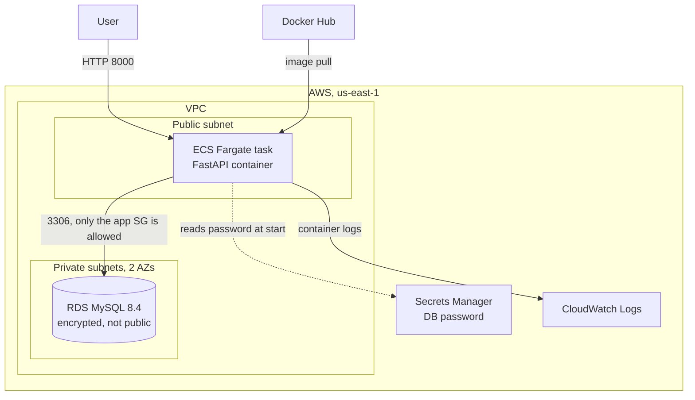
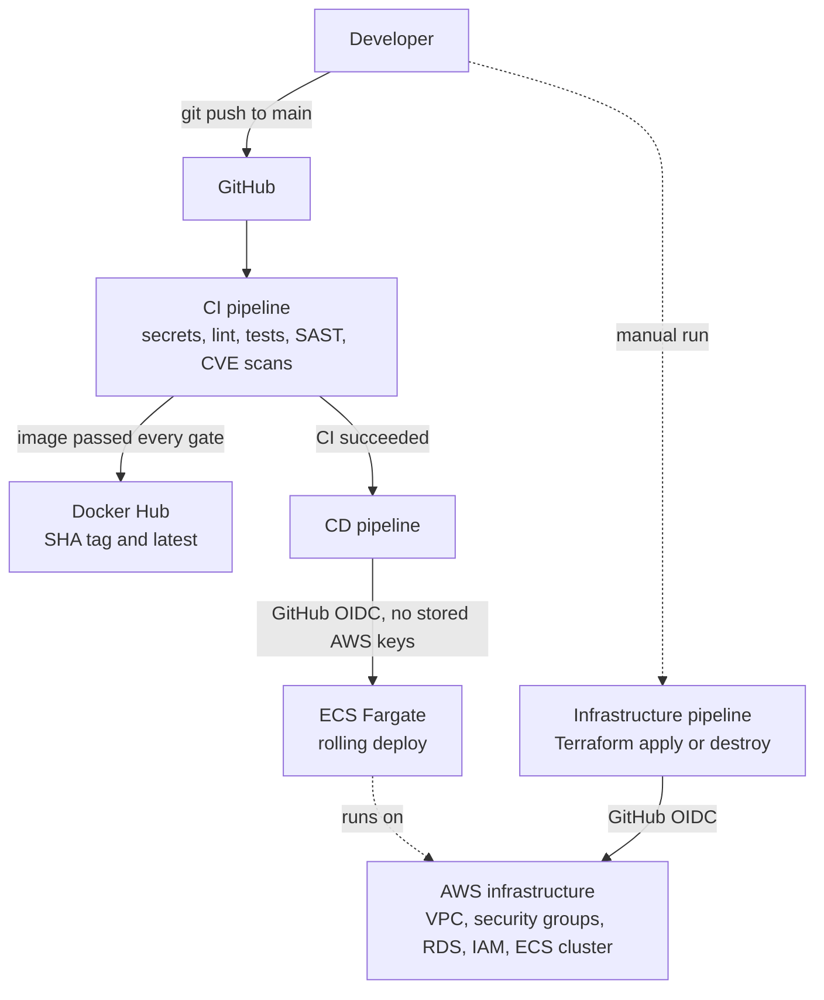
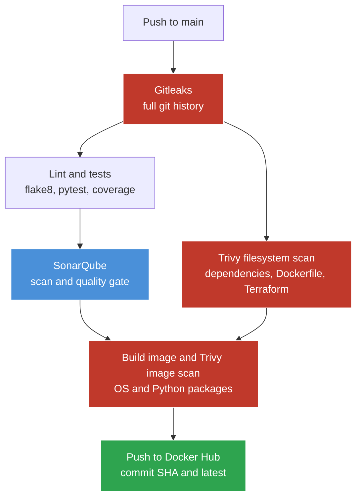
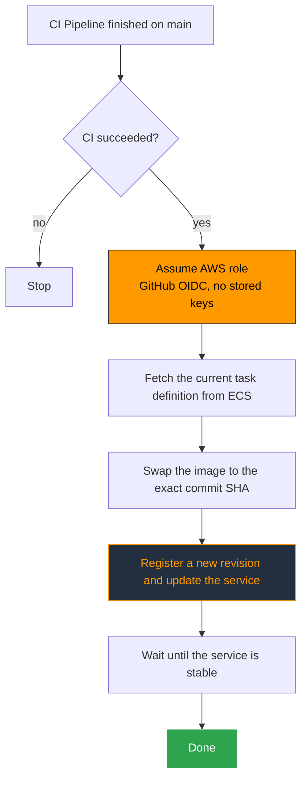
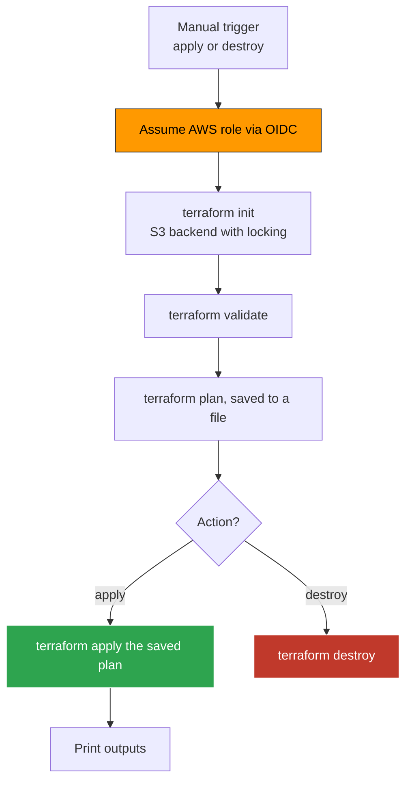
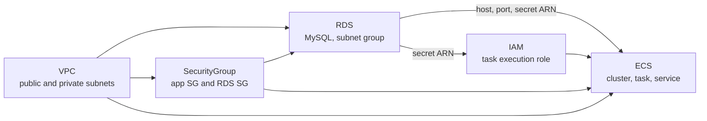
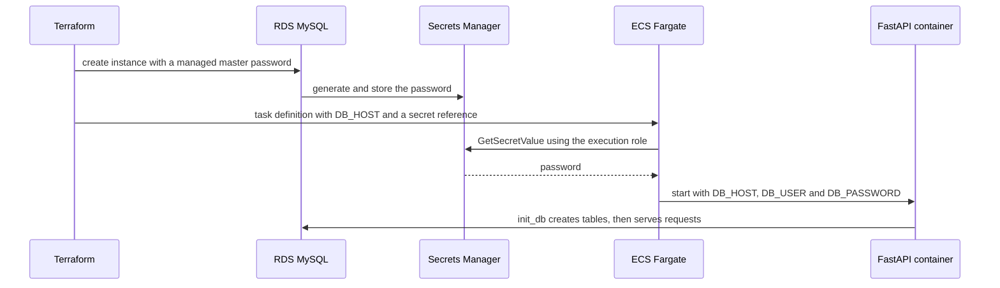

# URL Shortener: DevSecOps CI/CD on AWS ECS Fargate

[](https://github.com/ArshadKhan-007/URL-SHORTENER-CI-CD-ECS/actions/workflows/ci.yml)

A FastAPI URL shortener deployed to **AWS ECS Fargate** with a **private RDS MySQL** database, built to show a complete **DevSecOps pipeline**: every push is scanned for secrets, code issues, vulnerable dependencies and vulnerable images before anything reaches Docker Hub or AWS. Infrastructure is written in **Terraform** and kept in a separate, manually triggered pipeline.

The app is intentionally small. The pipeline and the infrastructure are the point of this project.

---

## Table of contents

1. [Architecture](#architecture)
2. [How everything fits together](#how-everything-fits-together)
3. [Tech stack](#tech-stack)
4. [The application](#the-application)
5. [CI pipeline](#ci-pipeline)
6. [CD pipeline](#cd-pipeline)
7. [Infrastructure pipeline](#infrastructure-pipeline)
8. [Terraform modules](#terraform-modules)
9. [How the app gets its database password](#how-the-app-gets-its-database-password)
10. [Security](#security)
11. [Trade-offs and what I would change for production](#trade-offs-and-what-i-would-change-for-production)
12. [Run it locally](#run-it-locally)
13. [Setup checklist](#setup-checklist)
14. [Project structure](#project-structure)

---

## Architecture



| Piece | Detail |
| --- | --- |
| Network | VPC `10.0.0.0/16`, public subnet `10.0.1.0/24` (us-east-1a), private subnets `10.0.10.0/24` (us-east-1a) and `10.0.11.0/24` (us-east-1b), internet gateway on the public route table only |
| Compute | ECS Fargate, 0.25 vCPU / 512 MB, one task in a public subnet |
| Database | RDS MySQL 8.4 in private subnets, encrypted, `publicly_accessible = false` |
| Network access | The RDS security group accepts port 3306 **only from the app security group**, never from a CIDR range |
| DB password | Generated and stored by RDS in Secrets Manager. It never appears in code, variables or Terraform state |
| Logs | CloudWatch log group `/ecs/url-shortener`, 7 day retention |
| Registry | Docker Hub, tagged with the commit SHA and `latest` |

---

## How everything fits together



Two pipelines, two rhythms:

| | CI / CD | Infrastructure |
| --- | --- | --- |
| Trigger | Automatic on every push to `main` | **Manual only** (`workflow_dispatch`) |
| Manages | App image and ECS service updates | VPC, security groups, RDS, IAM, ECS cluster |
| Risk | Low, rolling update, easy to roll back | Higher, can destroy live infrastructure, so a human decides |

Code changes all the time, infrastructure should change only on purpose. Running `terraform apply` on every push would touch live networking and the database for no reason.

---

## Tech stack

| Area | Tools |
| --- | --- |
| Backend | FastAPI, Python 3.11, SQLAlchemy, PyMySQL |
| Database | MySQL 8.4 (Amazon RDS) |
| Container | Docker, non-root user, Docker Compose for local development |
| Cloud | AWS ECS Fargate, RDS, VPC, Secrets Manager, CloudWatch, IAM |
| IaC | Terraform with an S3 backend and state locking |
| CI/CD | GitHub Actions |
| Security | Gitleaks, SonarQube, Trivy (filesystem and image), GitHub OIDC |
| Registry | Docker Hub |

---

## The application

| Method | Endpoint | What it does |
| --- | --- | --- |
| `POST` | `/shorten` | Shorten one URL. Optional custom alias and expiry |
| `POST` | `/shorten/bulk` | Shorten many URLs in one call |
| `GET` | `/{short_code}` | Redirect (302) to the original URL. `404` if unknown, `410` if expired |
| `GET` | `/stats/{short_code}` | Click count and metadata |
| `GET` | `/qr/{short_code}` | QR code PNG for the short URL |
| `GET` | `/health` | Liveness plus database connectivity check |

Interactive docs are served at `/docs`. On container start, `python -m app.init_db` creates the tables if they do not exist, then Uvicorn starts.

---

## CI pipeline



| Job | Needs | Why it sits here |
| --- | --- | --- |
| `gitleaks` | none | First on purpose. If a secret leaked, nothing else should run on that code |
| `ci` | `gitleaks` | flake8, pytest and a coverage report |
| `trivy-fs` | `gitleaks` | Needs only repository files, so it runs **in parallel** with `ci` |
| `sonar` | `ci` | Needs `coverage.xml` from `ci` (passed as an artifact) |
| `trivy-image` | `sonar`, `trivy-fs` | Builds the image locally and scans it. Runs only after every earlier gate is green |
| `docker` | `trivy-image` | Logs in to Docker Hub and pushes only after the image scan passes |

**Rule used:** if a job needs another job's output, use `needs`. If not, run it in parallel and save time.

What each stage checks:

- **Gitleaks** scans the whole git history, not just the last commit. A secret deleted in a later commit is still in history and still gets caught.
- **Trivy filesystem** scans `requirements.txt` for CVEs, the `Dockerfile` for misconfigurations and the Terraform code for AWS misconfigurations. Secret scanning is off here because Gitleaks already covers it.
- **SonarQube** checks the code I wrote: bugs, code smells, security hotspots and coverage. The Quality Gate blocks the pipeline if it fails. Trivy checks the packages I installed, SonarQube checks my own code.
- **Trivy image** scans the built image (base OS and every Python package) and fails on fixable `HIGH` or `CRITICAL` findings. The image is scanned **before** it is pushed, so a vulnerable image never reaches the registry.

---

## CD pipeline



- **Only runs after CI succeeds.** CD listens for the CI workflow to finish and continues only when it passed.
- **Deploys the exact image that was scanned.** The task definition uses the commit SHA, never `latest`.
- **Terraform owns the config, CD owns the image.** CD downloads the live task definition (environment variables, secret references, roles all come from Terraform) and only replaces the image. Nothing environment-specific is hardcoded in the repository, which matters because the RDS secret ARN changes every time the database is recreated.
- **No overlapping deploys.** `concurrency: deploy-production` queues deploys instead of running them at once.
- **No stored AWS keys.** GitHub issues a short-lived signed token, AWS validates it against its OIDC provider, and an IAM role locked to this repository and the `main` branch returns temporary credentials for that single run.

---

## Infrastructure pipeline



- **Plan first, apply the same plan.** `plan -out=tfplan`, then `apply` uses that exact file.
- **Terraform and CD do not fight.** The ECS service has `ignore_changes = [task_definition]`, so a later `terraform apply` does not roll back the image CD deployed.
- **Remote state** lives in S3 with lockfile-based locking, so two runs cannot corrupt the state.

---

## Terraform modules



| Module | Creates |
| --- | --- |
| `VPC` | VPC, internet gateway, one public subnet, two private subnets in different AZs, route tables |
| `SecurityGroup` | App SG (port 8000 in) and RDS SG (port 3306 only from the app SG, no egress) |
| `RDS` | DB subnet group and the MySQL instance with a Secrets Manager managed master password |
| `IAM` | ECS task execution role, plus read access to the one DB secret |
| `ECS` | Cluster with Container Insights, CloudWatch log group, task definition, Fargate service |

---

## How the app gets its database password



The password is never typed, committed or passed through Terraform variables. ECS fetches it at container start and injects it as an environment variable.

---

## Security

| What | Tool or control | Blocks the build if |
| --- | --- | --- |
| Leaked secrets in git history | Gitleaks | Any secret is found |
| Code quality and code security | SonarQube Quality Gate | The gate fails |
| Vulnerable dependencies | Trivy filesystem | Fixable HIGH or CRITICAL CVE |
| Dockerfile and Terraform misconfiguration | Trivy filesystem | HIGH or CRITICAL finding |
| Vulnerable container image | Trivy image, before the push | Fixable HIGH or CRITICAL CVE |
| Container running as root | Non-root `USER` | Image would be flagged |
| Long-lived AWS credentials | GitHub OIDC, role trust limited to this repo and `main` | Nothing long-lived exists |
| Deploying broken code | CD runs only when CI succeeded | CI failed |
| Deploying the wrong image | Image tag is the commit SHA | Cannot happen by design |
| Database exposure | Private subnets, no public IP, SG-to-SG rule | Not reachable from the internet |
| Database password handling | RDS managed secret in Secrets Manager | Never in code or state |

Hardening done in the image:

- Runs as a non-root user.
- OS packages are upgraded at build time so fixed CVEs in the base image are picked up.
- `setuptools` and `wheel` are removed after install because the app does not need them at runtime.
- Runtime and dev dependencies are split (`requirements.txt` and `requirements-dev.txt`), so the image stays small.

---

## Trade-offs and what I would change for production

These are deliberate choices for a learning project, written down so they are not hidden:

| Today | In production |
| --- | --- |
| ECS task in a public subnet with a public IP (no NAT gateway or load balancer, to avoid the cost) | Private subnets behind an Application Load Balancer, with NAT or VPC endpoints |
| The public IP changes on every deploy, plain HTTP on port 8000 | ALB with an ACM certificate and a Route 53 domain |
| One task in one AZ | Multiple tasks across AZs with autoscaling |
| App connects with the RDS master user | A separate least-privilege database user for the app |
| Single-AZ `db.t4g.micro` | Multi-AZ, larger instance class |
| Security group egress is open (`AWS-0104`) and the subnet assigns public IPs (`AWS-0164`), both accepted in the code with a reason | Egress limited to what is needed, private subnets |
| `terraform apply` runs with `-auto-approve` once triggered | A required reviewer on a GitHub Environment before apply and destroy |
| GitHub Actions pinned by tag | Pinned by commit SHA |

---

## Run it locally

RDS lives in private subnets, so locally the app talks to a MySQL container instead.

```bash
git clone https://github.com/ArshadKhan-007/URL-SHORTENER-CI-CD-ECS.git
cd URL-SHORTENER-CI-CD-ECS
cp .env.example .env
docker compose up --build
```

API docs: `http://localhost:8000/docs`, health check: `http://localhost:8000/health`.

`DB_NAME`, `DB_USER` and `DB_PASSWORD` in `.env` must match `MYSQL_DATABASE`, `MYSQL_USER` and `MYSQL_PASSWORD`.

Without Docker:

```bash
python3 -m venv venv
source venv/bin/activate
pip install -r requirements-dev.txt
uvicorn app.main:app --reload
```

Lint and tests (tests use SQLite, no MySQL needed):

```bash
flake8 app/ tests/
coverage run -m pytest tests/ -v --tb=short
coverage report
```

---

## Setup checklist

**GitHub repository secrets:** `DOCKERHUB_USERNAME`, `DOCKERHUB_TOKEN`, `SONAR_TOKEN`, `SONAR_HOST_URL`
**GitHub repository variable:** `AWS_ROLE_ARN`

**One-time AWS setup (done by hand, not by Terraform):**
1. An S3 bucket for Terraform state (name set in `aws-infrastructure/backend.tf`).
2. The GitHub OIDC identity provider (`token.actions.githubusercontent.com`).
3. An IAM role that trusts this repository and the `main` branch, with permissions for the services Terraform manages.

**Deploy order:**
1. Run **Infrastructure Pipeline** with `apply` (about 10 minutes, RDS is the slow part).
2. Push to `main`. CI runs, then CD deploys.
3. Open `http://<task-public-ip>:8000/health` and check that `database` says `connected`.

**Cost note:** RDS and the public IP are billed while they exist. Destroy the stack when you are done testing. `db_deletion_protection` defaults to `true`, so set it to `false` and apply before running `destroy`.

---

## Project structure

```
.
├── .github/workflows/
│   ├── ci.yml                  # secrets, lint, tests, SonarQube, Trivy, push to Docker Hub
│   ├── cd.yml                  # OIDC, swap image in the live task definition, deploy to ECS
│   └── infrastructure.yml      # manual Terraform apply / destroy
├── app/                        # FastAPI application
│   ├── main.py
│   ├── crud.py
│   ├── models.py
│   ├── database.py
│   ├── schemas.py
│   ├── config.py
│   └── init_db.py              # creates tables on container start
├── tests/                      # pytest tests (SQLite)
├── aws-infrastructure/         # Terraform
│   ├── main.tf  variables.tf  outputs.tf  provider.tf  backend.tf
│   └── modules/
│       ├── VPC/
│       ├── SecurityGroup/
│       ├── RDS/
│       ├── IAM/
│       └── ECS/
├── Dockerfile
├── docker-compose.yml          # local app + MySQL
├── requirements.txt            # runtime dependencies
├── requirements-dev.txt        # runtime + lint/test tools
└── sonar-project.properties
```

---

## Why this project exists

Most CI/CD portfolio projects stop at "it builds and it deploys". This one also catches leaked secrets, unsafe dependencies, misconfigured infrastructure and vulnerable images before anything ships. It reaches AWS without storing long-lived keys, keeps the database private with its password in Secrets Manager, and separates application deploys from infrastructure changes.
